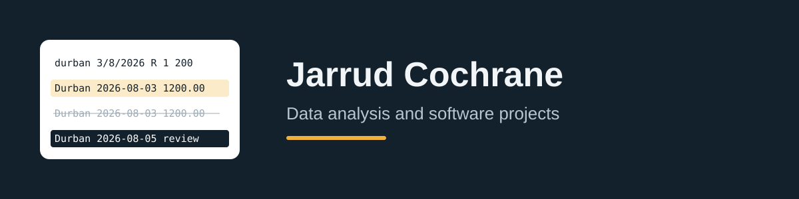
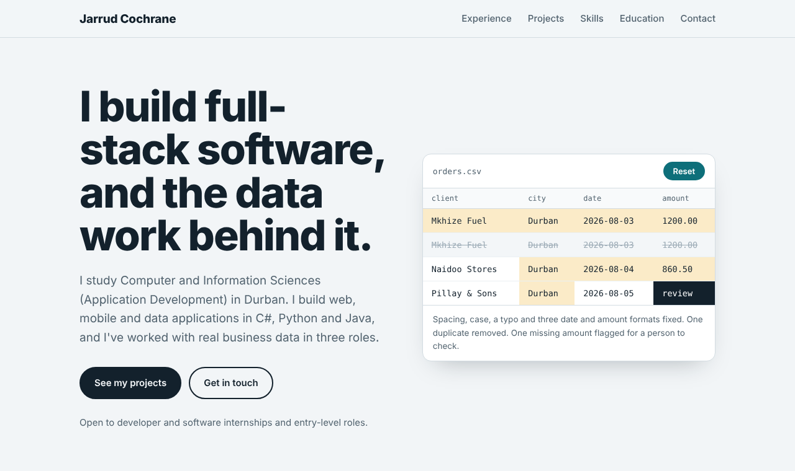

<a id="top"></a>

<p align="center">
  
</p>

# Jarrud Cochrane: Portfolio

**A single-page portfolio showing my full-stack software projects, data experience and skills.**

I'm a full-stack developer in Durban, South Africa, with a Bachelor of Computer and Information Sciences (Application Development). This site is where I keep my projects, experience, skills and certificates in one place.

<p align="left">
  
  
  
  
</p>

**[Visit the live site](https://jarrudcochrane.github.io/portfolio) · [What's on it](#whats-on-the-site) · [Run it locally](#run-it-locally) · [Update it](#update-the-site) · [Contact](#contact)**

## The idea

| The problem | How the site handles it |
| :--- | :--- |
| Recruiters skim. A long CV hides the work. | The hero opens with a short headline and a small live demo: a messy table that cleans itself. |
| Projects on GitHub are hard to find and judge. | Each project has a short plain-English summary, its tech stack and a link to the code. |
| Claims on a CV are easy to doubt. | The NexAfrica internship certificate can be opened from the Experience section. |

## Preview

<p align="center">
  
</p>

## What's on the site

| Section | Contents |
| :--- | :--- |
| **Hero** | A table of messy data that cleans itself. Click **Clean it** and **Reset** to replay it. |
| **About** | How I build software and the kind of developer role I'm looking for |
| **Experience** | NexAfrica, UBUNTU Business Advisory and JLS FMS, plus the NexAfrica certificate |
| **Projects** | GLMS, a client fuel delivery platform, Budget Budz, Data Quality Pipeline and Golf Performance Tracker |
| **Skills** | Programming, data, cloud, AI tools and everyday tools |
| **Education and certificates** | Degree, Higher Certificate, matric, and Google, Microsoft and freeCodeCamp credentials |
| **Contact** | Email, LinkedIn and GitHub |

## Featured projects

| Project | What it is | Code |
| :--- | :--- | :--- |
| **Global Logistics Management System** | ASP.NET Core MVC app for clients, contracts and service requests, with tests and CI | [global-logistics-management-system](https://github.com/jarrudcochrane/global-logistics-management-system) |
| **Data Quality Pipeline** | Finds missing values, duplicates, outliers and format errors in CSV and Excel files, fixes the safe ones and flags the rest | [dq-pipeline](https://github.com/jarrudcochrane/dq-pipeline) |
| **Golf Performance Tracker** | Python and Streamlit analysis of golf rounds using rolling averages, trends and correlation | [golf-performance-tracker](https://github.com/jarrudcochrane/golf-performance-tracker) |

## Design choices

- **One file, no frameworks.** Everything lives in `index.html`, so it loads fast and is easy to edit.
- **Light, calm palette.** A cool paper background, dark ink text, a teal accent for links and a sun yellow highlight for fixed data.
- **Readable type.** Bricolage Grotesque for headings, Figtree for body text and IBM Plex Mono for data.
- **Accessible by default.** Keyboard focus is visible, the layout works on phones, and animation is switched off for people who ask their device to reduce motion.

## Tech stack

| Technology | Purpose |
| :--- | :--- |
| HTML5 | Page structure |
| CSS3 | Layout, colours and responsive design |
| Vanilla JavaScript | The cleaning demo and the certificate pop-up |
| Google Fonts | Bricolage Grotesque, Figtree and IBM Plex Mono |
| GitHub Pages | Free hosting |

## Project structure

```text
portfolio/
├── index.html                          The whole site: markup, styles and script
├── assets/
│   └── nexafrica-certificate.png       Internship certificate shown on the page
├── docs/
│   └── assets/
│       ├── portfolio-banner.svg        Banner used in this README
│       └── preview.png                 Screenshot used in this README
└── README.md
```

## Run it locally

No install and no build step.

```bash
git clone https://github.com/jarrudcochrane/portfolio.git
cd portfolio
```

Then open `index.html` in your browser.

## Update the site

1. Edit `index.html`.
2. Commit and push to `main`.
3. GitHub Pages republishes in a minute or two.

## Contact

- Email: jarrudcochrane03@gmail.com
- LinkedIn: [jarrud-cochrane](https://www.linkedin.com/in/jarrud-cochrane-a0320a368)
- GitHub: [@jarrudcochrane](https://github.com/jarrudcochrane)

[Back to top](#top)
